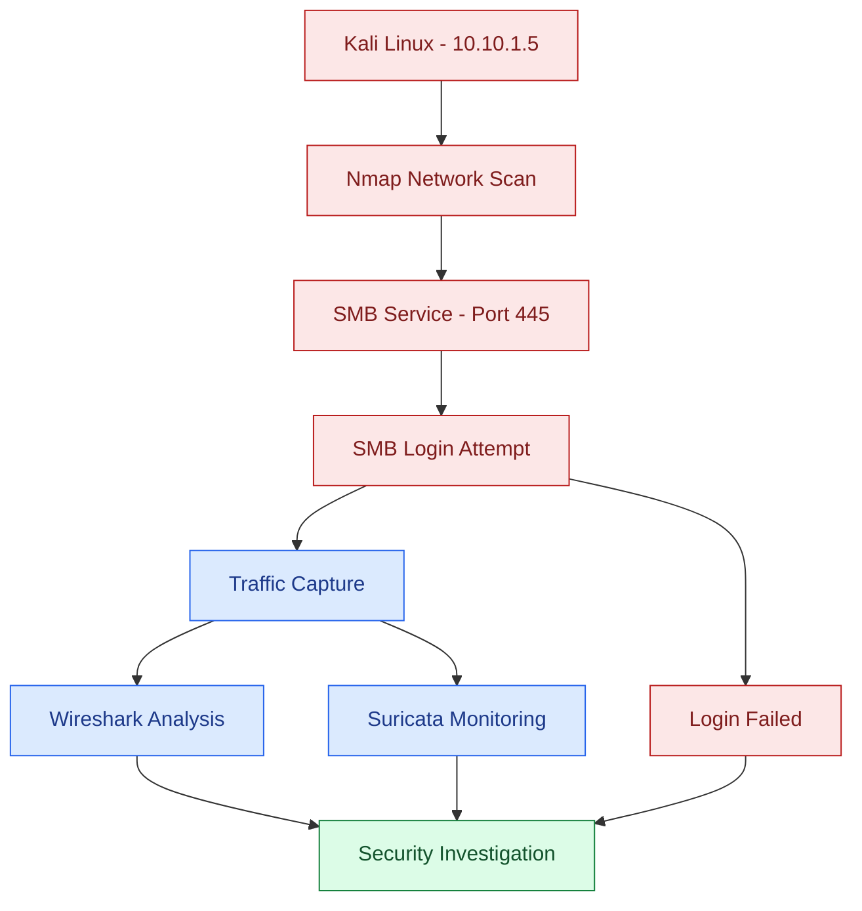

# SEC320 – Unauthorized SMB Access Detection

## Project Overview
This project demonstrates how unauthorized SMB login attempts can be monitored in a virtual cybersecurity lab. I used Kali Linux to simulate failed login attempts against a Windows 10 machine and used Wireshark and Suricata to investigate network traffic.

## Tools Used
- VMware Workstation
- Kali Linux
- Windows 10
- Ubuntu Router
- Nmap
- SMBClient
- Wireshark
- Suricata
- tcpdump

## Network Configuration
| Device | IP Address | Role |
|---|---|---|
| Kali Linux | 10.10.1.5 | Testing machine |
| Ubuntu Router | 10.10.1.1 / 172.16.1.1 | Network routing |
| Windows 10 | 172.16.1.15 | Target machine |
| Suricata VM | Monitoring interface | Traffic monitoring |

## Attack Flowchart

## Project Steps
### 1. Network Setup
Configured the virtual machines and verified connectivity between Kali Linux and Windows 10 through an Ubuntu router.

### 2. Network Scanning
Used Nmap to identify open services on the Windows machine, including SMB on port 445.

### 3. SMB Login Attempt
Used SMBClient to test unauthorized credentials. The attempt failed with `NT_STATUS_LOGON_FAILURE`.

### 4. Packet Analysis
Used Wireshark to examine SMB2 and NTLMSSP authentication packets.

### 5. Suricata Monitoring
Used Suricata and tcpdump to monitor network activity and review logs. A dedicated Suricata alert for the failed SMB login was not confirmed.

## Results
- Network connectivity was successful.
- Nmap identified open services.
- Unauthorized SMB login attempts failed.
- Wireshark captured authentication traffic.
- Suricata recorded network activity.

## Conclusion
This project helped me understand how unauthorized login attempts work and how network monitoring tools can help investigate suspicious activity. All testing was completed in an authorized virtual lab for educational purposes.
