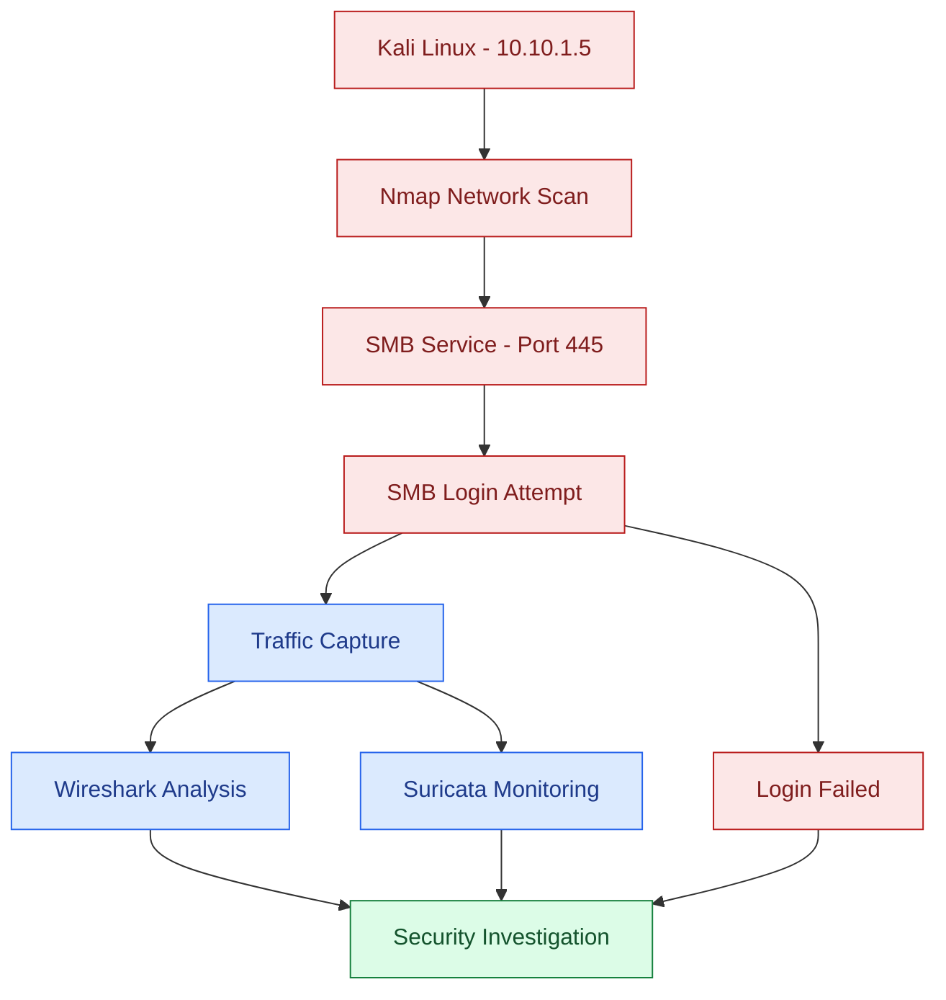
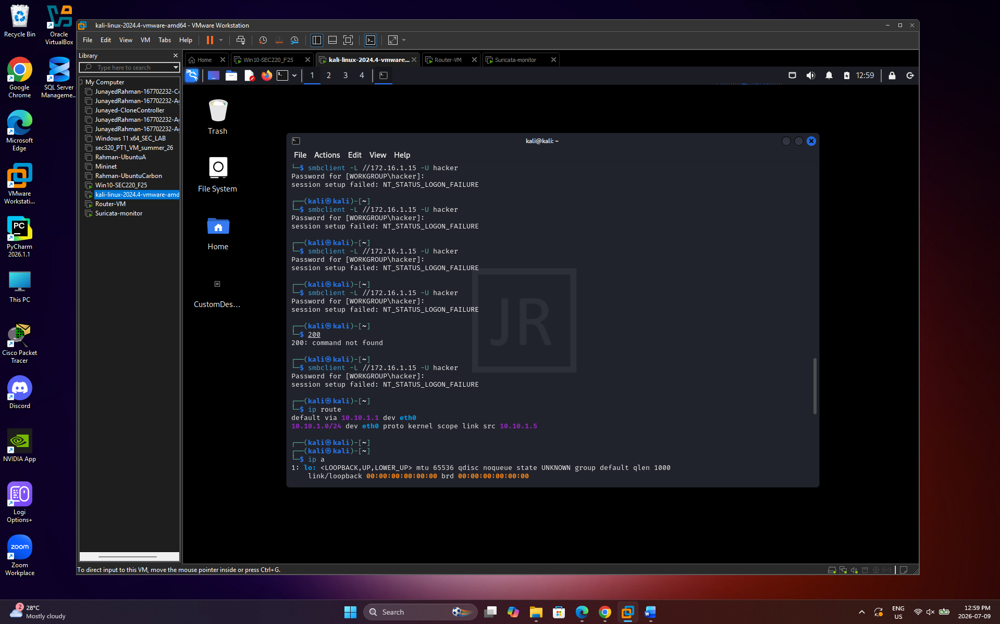
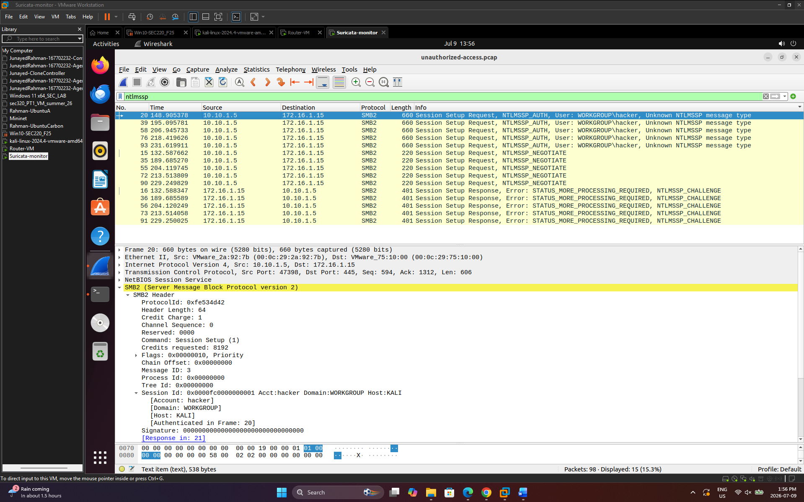

# SEC320 – Unauthorized SMB Access Detection

## Project Overview
This project demonstrates how unauthorized SMB login attempts can be monitored in a virtual cybersecurity lab. I used Kali Linux to simulate failed login attempts against a Windows 10 machine and used Wireshark and Suricata to investigate network traffic.

## Tools Used
- VMware Workstation
- Kali Linux
- Windows 10
- Ubuntu Router
- Nmap
- SMBClient
- Wireshark
- Suricata
- tcpdump

## Network Configuration
| Device | IP Address | Role |
|---|---|---|
| Kali Linux | 10.10.1.5 | Testing machine |
| Ubuntu Router | 10.10.1.1 / 172.16.1.1 | Network routing |
| Windows 10 | 172.16.1.15 | Target machine |
| Suricata VM | Monitoring interface | Traffic monitoring |

## Attack Flowchart

## Project Steps
### 1. Network Setup
Configured the virtual machines and verified connectivity between Kali Linux and Windows 10 through an Ubuntu router.

### 2. Network Scanning
Used Nmap to identify open services on the Windows machine, including SMB on port 445.

### 3. SMB Login Attempt
Used SMBClient to test unauthorized credentials. The attempt failed with `NT_STATUS_LOGON_FAILURE`.

### 4. Packet Analysis
Used Wireshark to examine SMB2 and NTLMSSP authentication packets.

### 5. Suricata Monitoring
Used Suricata and tcpdump to monitor network activity and review logs. A dedicated Suricata alert for the failed SMB login was not confirmed.

## Results
- Network connectivity was successful.
- Nmap identified open services.
- Unauthorized SMB login attempts failed.
- Wireshark captured authentication traffic.
- Suricata recorded network activity.

## Skills Demonstrated

- Network reconnaissance and service discovery using Nmap
- SMB authentication testing in a controlled lab environment
- Network packet capture and protocol analysis using Wireshark
- Intrusion detection monitoring using Suricata
- Investigation of network traffic and security logs
- Virtual machine networking and troubleshooting
- Cybersecurity documentation and evidence collection

## Conclusion
This project helped me understand how unauthorized login attempts work and how network monitoring tools can help investigate suspicious activity. All testing was completed in an authorized virtual lab for educational purposes.

## Project Screenshots

### 1. Windows Target Configuration

I used Windows 10 as the target machine. I checked its IP address to confirm the network setup.

### 2. Network Scanning

I used Kali Linux and Nmap to scan the Windows machine. The scan showed that SMB was running on port 445, along with other open services.

### 3. Failed SMB Login Attempt

I used SMBClient to try logging into the Windows machine with incorrect credentials. The login was rejected with NT_STATUS_LOGON_FAILURE.

### 4. Suricata Monitoring

I started Suricata on the monitoring VM and confirmed that the service was running. I also used tcpdump to capture network traffic.

### 5. Wireshark Packet Analysis

I opened the captured network traffic in Wireshark and used the ntlmssp filter to examine SMB authentication packets. The packets showed the login attempts from Kali Linux to Windows.

### 6. Suricata Logs

I reviewed Suricata's fast.log and JSON event logs to check the recorded network activity. The logs showed network activity, but a specific alert for the failed SMB login was not confirmed.

## Final Summary

In this project, I learned how to test unauthorized SMB login attempts in a virtual lab. I used Nmap to identify services, SMBClient to test authentication, Wireshark to analyze packets, and Suricata to monitor network activity.

The login attempts were unsuccessful, and the captured traffic helped me understand how security teams can investigate suspicious login activity.

All testing was completed in an authorized virtual lab for educational purposes.
